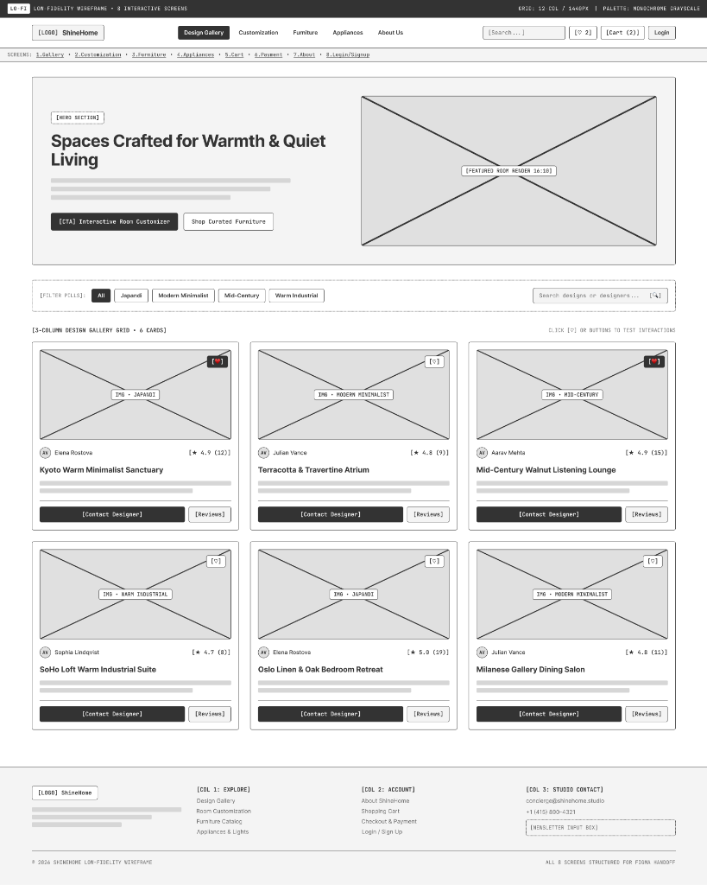
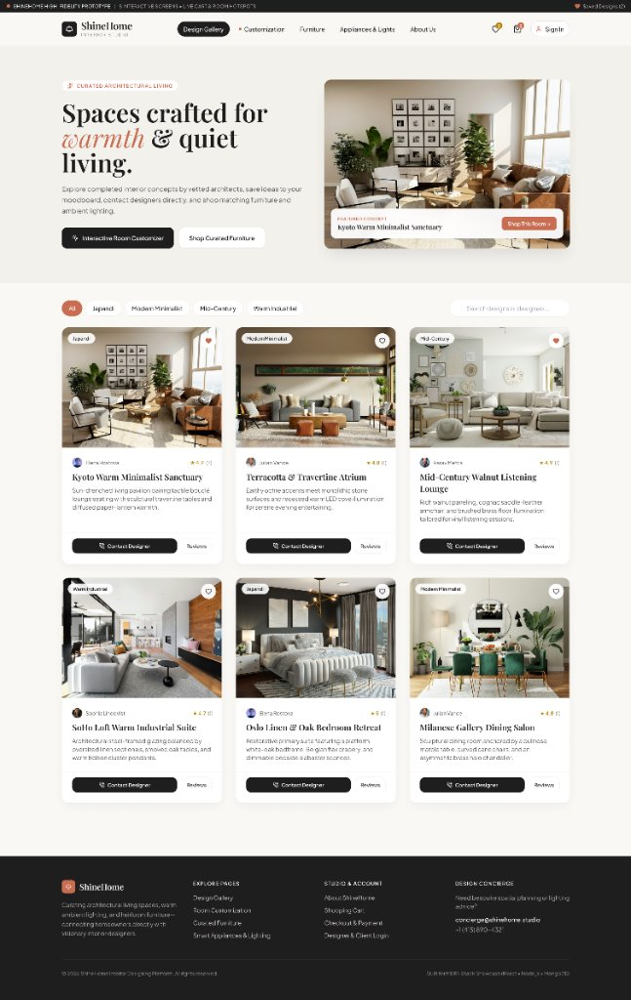

# ShineHome — Product Requirements Document (PRD)

> **Source Document:** [ShineHome_PRD.pdf](./docs/ShineHome_PRD.pdf)  
> **UI/UX Prototypes:** [Low-Fidelity Wireframe](./docs/low-fidelity-wireframe.png) | [High-Fidelity Design](./docs/high-fidelity-design.png)

---

## 1. Product Overview

**ShineHome** is a full-stack interior designing and curated home commerce web platform designed to transform how homeowners explore, customize, and bring interior design concepts to life. Users can browse a curated gallery of architectural room concepts, save favorite inspirations to a personal moodboard, leave reviews for designs and products, connect directly with vetted interior designers, interactively inspect furniture and ambient lighting hotspots inside real room scenes, and purchase matching items through an integrated checkout flow.

---

## 2. Core Project Features

1. **Curated Design Gallery:** Showcases completed interior concepts across distinct architectural styles (`Japandi`, `Modern Minimalist`, `Mid-Century`, `Warm Industrial`) with high-resolution imagery and rich descriptions.
2. **Favorites & Moodboard Persistence:** Authenticated users (and guest sessions) can favorite/unfavorite interior designs for future reference, synchronized with live navbar badges.
3. **Community Feedback & Reviews:** Homeowners can read verified ratings and submit reviews/feedback on both interior design concepts and individual furniture/appliance products.
4. **Direct Designer Contact:** Built-in designer outreach modal inside the gallery allowing users to contact architects directly via phone, email, or a structured project inquiry form.
5. **Ambient Lighting & Appliance Selection:** Dedicated catalog highlighting warm lighting fixtures and smart home appliances with technical specifications (wattage, Kelvin color temperature, lumens, and smart-home ecosystem compatibility).
6. **Curated Furniture Storefront:** Full furniture catalog enabling users to browse, filter, inspect dimensions/materials, and purchase complementary pieces.
7. **Real-Time Search & Multi-Facet Filtering:** Filter designs by style or search by title/designer name; filter products by category, style, price range, and keyword.
8. **Interactive Room Customization:** Clickable pulsing hotspot pins overlaid on room renders that link directly to live product inspection and instant add-to-cart actions.

---

## 3. Application Pages (8 Core Screens)

| # | Page Name | Route | Purpose & Key Capabilities |
|---|-----------|-------|----------------------------|
| 1 | **Design Gallery** | `/` | Hero showcase, style filter pills, real-time search, 3-column grid of 6 curated concepts, favorite heart toggle, star ratings, Reviews modal, and Contact Designer modal. |
| 2 | **Customization** | `/customize` | Interactive room canvas with pulsing product hotspot pins synced to a live inspector sidebar ("View Full Details" & "Add to Cart") and room switcher. |
| 3 | **Furniture** | `/furniture` | Filter sidebar (search, category, style, price range), 3-column catalog grid of 8 curated pieces, and Product Details modal with dimensions and customer reviews. |
| 4 | **Appliances & Lighting** | `/appliances` | Matching filter sidebar + catalog grid of 6 lighting/home appliances highlighting technical spec badges (wattage, Kelvin warmth, smart-home support). |
| 5 | **Cart** | `/cart` | Itemized shopping cart with product thumbnails, quantity steppers (`- 1 +`), remove controls, and sticky Order Summary (subtotal, shipping, tax, total). |
| 6 | **Payment** | `/checkout` | Shipping & billing details form, tabbed payment methods (**UPI**, **Credit Card**, **Debit Card**), order creation API integration, and confirmation receipt. |
| 7 | **About Us** | `/about` | Brand story, architectural philosophy, 3-step "How ShineHome Works" workflow, and platform metrics. |
| 8 | **Login & Signup** | `/login` | Split-screen authentication view supporting JWT-backed Sign In and Create Account workflows. |

---

## 4. Visual Design System

- **Color Palette:**
  - Primary Background: Warm Off-White (`#FAF8F5`)
  - Secondary Surface / Cards / Sidebars: Soft Sand (`#EFECE6`)
  - Primary Text & Dark Architectural Footer: Deep Charcoal (`#1E1E1E`)
  - Primary Accent (CTAs, active pills, badges): Terracotta (`#C86D51`)
  - Secondary Accent (ratings, highlights): Warm Brass (`#B8860B`)
- **Typography:**
  - Headings & Wordmark: `Playfair Display`
  - UI, Navigation, Specs & Body: `Plus Jakarta Sans`

---

## 5. Technology Stack (MERN)

- **Frontend:** React 18, Vite, React Router DOM, Tailwind CSS, Lucide React Icons
- **Backend:** Node.js, Express.js, JSON Web Tokens (`jsonwebtoken`), `bcryptjs`
- **Database:** MongoDB with Mongoose ODM

---

## 6. Design Evolution & UI/UX Artifacts

| Stage | Artifact | Description |
|-------|----------|-------------|
| **Days 1–2: Low-Fidelity Wireframe** | [low-fidelity-wireframe.png](./docs/low-fidelity-wireframe.png) | 12-column / 1440px monochrome structural blueprint mapping the navbar, hero, filter bar, 6-card gallery grid, and 4-column footer across all 8 screens. |
| **Day 3: High-Fidelity Prototype** | [high-fidelity-design.png](./docs/high-fidelity-design.png) | Warm architectural visual system combining `#FAF8F5` off-white canvas, `#EFECE6` sand surfaces, `#C86D51` terracotta accents, editorial serif typography, and interactive room photography. |

### Low-Fidelity Wireframe

### High-Fidelity Design

