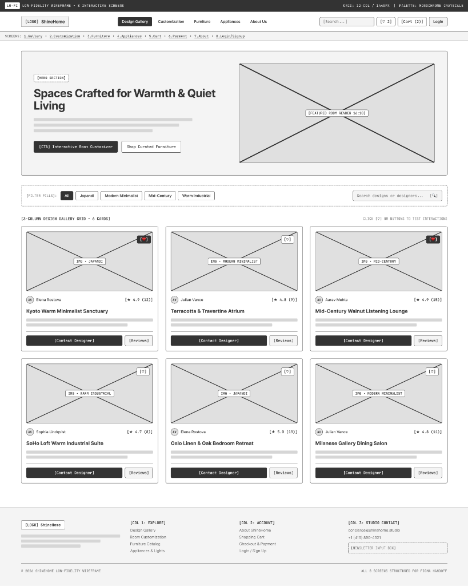
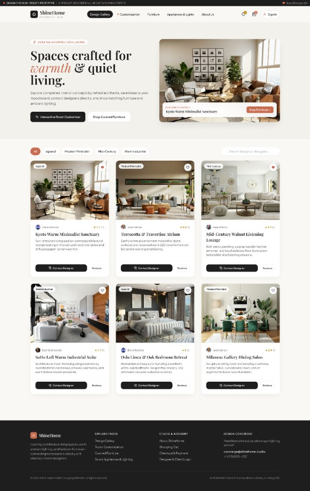

# ShineHome — Interior Designing & Curated Living Platform

ShineHome is a full-stack **MERN (MongoDB, Express.js, React, Node.js)** web application where homeowners explore curated architectural interior concepts, customize rooms with interactive furniture and lighting hotspots, connect directly with vetted designers, and shop heirloom furniture and smart ambient lighting.

---

## Documentation Index

- **[Product Requirements Document (PRD.md)](./PRD.md)** — Vision, 8-page feature breakdown, visual design tokens, and original PDF summary ([docs/ShineHome_PRD.pdf](./docs/ShineHome_PRD.pdf)).
- **[High-Level Design (HLD.md)](./HLD.md)** — 3-tier MERN architecture, ASCII system diagram, core modules, and data flows.
- **[Low-Level Design (LLD.md)](./LLD.md)** — Mongoose schemas (`User`, `Design`, `Product`, `Order`), complete REST API reference, and React component hierarchy.

---

## UI/UX Design Previews

| Low-Fidelity Wireframe | High-Fidelity Design |
| :---: | :---: |
|  |  |

---

## Visual Design System

- **Primary Background:** Warm Off-White (`#FAF8F5`)
- **Secondary Surface / Cards:** Soft Sand (`#EFECE6`)
- **Primary Text & Footer:** Deep Charcoal (`#1E1E1E`)
- **Primary Accent:** Terracotta (`#C86D51`)
- **Secondary Accent:** Warm Brass (`#B8860B`)
- **Typography:** `Playfair Display` (headings & wordmark) + `Plus Jakarta Sans` (navigation, UI & specs)

---

## Key Features & 8 Pages

1. **Design Gallery (`/`):** Hero showcase, architectural style filter pills, real-time search, 6 curated room concepts, favorite heart toggles, star ratings, Reviews modal, and Contact Designer modal.
2. **Customization (`/customize`):** Interactive room canvas with pulsing product hotspot pins synced to a live inspector panel (`View Full Details` & `Add to Cart`).
3. **Furniture (`/furniture`):** Multi-facet filter sidebar (search, category, style, price range), 8 curated furniture pieces, and Product Details modal with dimensions and reviews.
4. **Appliances & Lighting (`/appliances`):** Technical spec badges (wattage, Kelvin warmth, smart-home compatibility) across 6 curated fixtures & appliances.
5. **Cart (`/cart`):** Itemized shopping cart with quantity steppers, item removal, and sticky order summary.
6. **Payment (`/checkout`):** Shipping/billing form + tabbed payment methods (**UPI**, **Credit Card**, **Debit Card**) + order confirmation receipt.
7. **About Us (`/about`):** Brand mission, 3-step "How ShineHome Works" workflow, and platform highlights.
8. **Login & Signup (`/login`):** Split-screen JWT authentication flow.

---

## Project Structure

```text
ShineHome/
├── docs/
│   ├── ShineHome_PRD.pdf
│   ├── low-fidelity-wireframe.png
│   └── high-fidelity-design.png
├── server/
│   ├── config/db.js
│   ├── middleware/auth.js
│   ├── models/ (User, Design, Product, Order)
│   ├── routes/ (auth, designs, products, orders)
│   ├── utils/seedData.js
│   ├── seed.js
│   ├── server.js
│   └── .env.example
├── client/
│   ├── src/
│   │   ├── components/
│   │   ├── context/
│   │   ├── pages/
│   │   ├── services/api.js
│   │   ├── App.jsx
│   │   └── index.css
│   ├── index.html
│   └── tailwind.config.js
├── PRD.md
├── HLD.md
├── LLD.md
└── README.md
```

---

## Setup & Run Instructions

### Prerequisites
- **Node.js** v18+ and **npm** v9+
- **MongoDB** (local `mongod` instance or MongoDB Atlas URI). *Note: If no local MongoDB daemon is running, the backend includes an automatic `mongodb-memory-server` development fallback that auto-seeds sample data.*

### 1. Configure Backend (`/server`)
```bash
cd server
npm install
cp .env.example .env
```
Edit `server/.env` as needed:
```env
MONGO_URI=mongodb://127.0.0.1:27017/shinehome
JWT_SECRET=your_super_secret_jwt_key
PORT=5000
```

### 2. Seed the Database
```bash
cd server
npm run seed
```
This populates **6 curated interior designs** (with interactive room hotspot coordinates), **8 furniture products**, **6 lighting/home appliances** (with technical specs), and **customer reviews**.

### 3. Start Backend Server
```bash
cd server
npm run dev
```
The API server starts on `http://localhost:5000`.

### 4. Configure & Start Frontend (`/client`)
In a second terminal:
```bash
cd client
npm install
npm run dev
```
Open `http://localhost:5173` in your browser.
